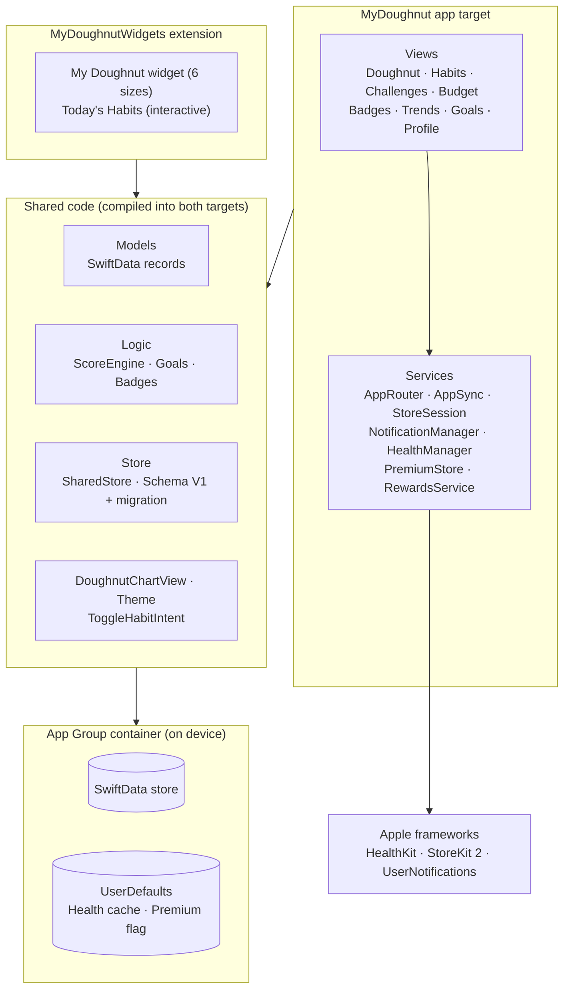

<div align="center">


# MyDoughnut

**Live well. Spend wisely. Protect the planet.**

A personal Doughnut Economics tracker for iPhone and iPad. Each week it shows whether your daily choices meet your own needs without overshooting the planet's limits.


[User Guide](docs/USER_GUIDE.md) · [Privacy Policy](docs/privacy.html) · [Developer Notes](docs/DEVELOPER_NOTES.md)

</div>

---

## Contents

- [About](#about)
- [Features](#features)
- [How scoring works](#how-scoring-works)
- [Screenshots](#screenshots)
- [Requirements](#requirements)
- [Getting started](#getting-started)
- [Configuration](#configuration)
- [Architecture](#architecture)
- [Project structure](#project-structure)
- [Testing](#testing)
- [Premium (in-app subscription)](#premium-in-app-subscription)
- [Privacy](#privacy)
- [Releasing to the App Store](#releasing-to-the-app-store)
- [Roadmap](#roadmap)
- [Known limitations](#known-limitations)
- [Contributing](#contributing)
- [Acknowledgements](#acknowledgements)
- [License](#license)

---

## About

Most lifestyle apps track one thing: money, calories, steps. **MyDoughnut** brings wellbeing, personal finance, sustainability and community together in one visual dashboard. It's based on Kate Raworth's *Doughnut Economics*, which pictures a **safe and just space** between two boundaries:

- **The social foundation** (inner ring): what you need to live well.
- **The ecological ceiling** (outer ring): what the planet can sustain.

MyDoughnut scores **12 areas** over the last 7 days. If you fall short on a need, a red wedge grows **inward**; if you overshoot a planet limit, it grows **outward**. Staying in the green ring is the goal.

| Life Needs (inner ring) | Planet Impact (outer ring) |
| --- | --- |
| Physical health | Carbon footprint |
| Mental wellbeing | Energy usage |
| Education | Transport |
| Income | Waste |
| Housing | Water |
| Community | Sustainable purchases |

> **Status:** pre-release. The code is complete; the first compile on a Mac and the App Store Connect setup are the next steps. See [Releasing to the App Store](#releasing-to-the-app-store).

---

## Features

### Core (free)

| Feature | Description |
| --- | --- |
| **Doughnut dashboard** | A live, interactive doughnut chart with shortfall and overshoot wedges. Tap any segment for details |
| **Daily check-in** | Rate any of the 12 areas from 1 to 5 (5 is always best), or **Skip** areas that don't apply. Takes about a minute |
| **Life Needs and Planet Impact pages** | Per-ring summary, score chart with targets, area list, tips and related challenges |
| **Habits** | Daily habits linked to areas, a 7-day date strip, streaks and haptics |
| **Weekly challenges** | 14 challenges; 4 are featured each week, rotating every Monday |
| **Impact Budget** | Money and estimated CO₂e side by side, sustainable share of spend, carbon by category |
| **Levels and badges** | XP, 8 levels from *Seedling* to *Ecosystem*, and 9 badges that are kept permanently |
| **Trends** | Week-by-week balance, Life Needs and Planet Impact (last 4 weeks free) |
| **Widgets** | Home Screen (small/medium/large), Lock Screen (circular/rectangular/inline), and an **interactive Today's Habits** widget |
| **Reminders** | Daily check-in (skipped once you've checked in), streak-at-risk and challenge last-call notifications |
| **Apple Health** | Optional, read-only: steps, exercise, sleep, mindful minutes, walking and cycling distance |
| **Deep links** | `mydoughnut://checkin`, `needs`, `planet`, `trends`, `habits`, `challenges`, `budget`, `badges` |
| **App icon** | Default, Dark and Tinted variants for iOS 18 Home Screens |

### Premium (£4.99/month, 1-week free trial)

- **Trends** over 12 weeks, 6 months and 1 year.
- **Monthly best and worst** area.
- **Personal goals:** your own target for every area, plus step, exercise, sleep and active-travel goals. Applied everywhere, including widgets.

---

## How scoring works

Each area gets a score from **0 to 100**, where higher is always better. It's **in balance** when it reaches its target: 50 by default, or a personal goal with Premium.

| Input | Contribution |
| --- | --- |
| Check-in rating | 1 → 0, 2 → 25, 3 → 50, 4 → 75, 5 → 100 (averaged over rated days) |
| Purchases | Sustainable share of spend sets *Sustainable purchases*. Estimated CO₂e against your weekly carbon budget feeds *Carbon footprint* |
| Apple Health | Steps and exercise feed *Physical health*. Sleep feeds *Mental wellbeing* (+ up to 10 for mindful minutes). Walking and cycling add up to +15 to *Transport* |
| Habits | +3 per completion, up to +15 per area |
| Challenges | +10 per completed challenge, up to +20 per area |

The inputs are averaged, the bonuses added, and the result clamped to 0–100. The logic lives in [`Shared/Logic/ScoreEngine.swift`](Shared/Logic/ScoreEngine.swift); the [User Guide](docs/USER_GUIDE.md#5-how-your-scores-work) has a worked example.

> Carbon figures are rough spend-based estimates (kg CO₂e per £, by category) to help compare choices. Replace them with official UK government conversion factors before launch.

---

## Screenshots

<div align="center">

</div>

> Add app screenshots to `docs/images/` (e.g. `dashboard.png`, `checkin.png`, `trends.png`, `widgets.png`) and reference them here.

---

## Requirements

| Item | Version |
| --- | --- |
| Xcode | 16.0 or later (the project uses folder-synced groups) |
| iOS / iPadOS deployment target | 17.0 |
| Swift | 5.9+ (Swift 5 language mode) |
| Apple Developer account | Needed for App Groups, HealthKit and in-app purchases on a device |
| Third-party dependencies | **None.** Apple frameworks only: SwiftUI, SwiftData, Swift Charts, WidgetKit, App Intents, HealthKit, UserNotifications, StoreKit 2 |

---

## Getting started

```bash
git clone https://github.com/YOUR-USERNAME/mydoughnut.git
cd mydoughnut
open MyDoughnut.xcodeproj
```

1. **Signing:** select the **MyDoughnut** target, then **Signing & Capabilities**, and choose your Team. Repeat for the **MyDoughnutWidgets** target.
2. **Identifiers:** replace `com.example` with your own reverse domain everywhere (see [Configuration](#configuration)).
3. **Run:** pick an iPhone or iPad simulator and press **⌘R**.
4. **Widgets:** long-press the Home Screen, tap **+**, then choose **MyDoughnut**.
5. **Premium (optional):** go to **Product → Scheme → Edit Scheme → Run → Options → StoreKit Configuration** and choose `MyDoughnut.storekit`.

> Apple Health returns meaningful data only on a real device. In the simulator, add sample data in the Health app.

---

## Configuration

Change these identifiers together. They must match each other and your Apple Developer account.

| What | Default (placeholder) | Where to change it |
| --- | --- | --- |
| App bundle ID | `com.example.mydoughnut` | MyDoughnut target → General |
| Widget bundle ID | `com.example.mydoughnut.widgets` | MyDoughnutWidgets target → General (must start with the app ID) |
| App Group | `group.com.example.mydoughnut` | `MyDoughnut.entitlements`, `MyDoughnutWidgets.entitlements`, `Shared/Store/SharedStore.swift` (`AppGroup.id`) |
| Premium product ID | `com.example.mydoughnut.premium.monthly` | `MyDoughnut/Services/PremiumStore.swift`, `MyDoughnut.storekit`, App Store Connect |
| Privacy policy URL | `https://YOUR-GITHUB-USERNAME.github.io/mydoughnut/privacy.html` | `MyDoughnut/Services/AppLinks.swift` |
| Support email | `privacy@yourdomain.com` | `MyDoughnut/Services/AppLinks.swift`, `docs/privacy.html` |

Tunable values (targets, bonuses, budgets, reminder times) are listed in the [Developer Notes](docs/DEVELOPER_NOTES.md).

---

## Architecture



**Key design decisions**

- **One store, two processes.** The app and widget share a SwiftData store in an App Group. When the widget ticks a habit, it leaves a timestamp; on returning to the foreground, the app swaps in a fresh `ModelContext`, so iOS 17 shows the change straight away.
- **Versioned schema from day one.** `MyDoughnutSchemaV1` plus `MyDoughnutMigrationPlan` mean future model changes upgrade users' data safely. See the comments in [`Shared/Store/Schema.swift`](Shared/Store/Schema.swift).
- **No silent data loss.** If the shared store can't open, the app falls back to a local store and tells the user (Profile → Diagnostics).
- **Rewards are permanent.** Earned badges and best XP are saved as they happen, so deleting data never takes them away.
- **Central sync point.** `AppSync.refresh(_:)` runs after every meaningful change: it saves, awards badges, reloads widgets and reschedules reminders.

---

## Project structure

```text
MyDoughnut/
├── MyDoughnut.xcodeproj
├── MyDoughnut/                     # App target
│   ├── MyDoughnutApp.swift         # Entry point, root views, tabs, badge banner
│   ├── Logic/Trends.swift          # Weekly history + monthly best/worst
│   ├── Services/                   # Router, sync, notifications, Health, Premium, store session
│   ├── Views/                      # Onboarding, Dashboard, Habits, Challenges, Budget,
│   │                               # Achievements, Trends, Goals, Premium, Profile
│   ├── Assets.xcassets             # App icon (Default / Dark / Tinted), accent colour
│   └── PrivacyInfo.xcprivacy
├── Shared/                         # Compiled into app AND widget
│   ├── Models/                     # SwiftData models, 12 areas, categories, challenges
│   ├── Logic/                      # ScoreEngine, Goals, Achievements, date helpers
│   ├── Store/                      # SharedStore (App Group), Schema + migration plan
│   ├── Health/HealthSummary.swift
│   ├── Intents/ToggleHabitIntent.swift
│   ├── Theme/Theme.swift
│   └── Views/DoughnutChartView.swift
├── MyDoughnutWidgets/              # Widget extension target
│   ├── WidgetData.swift            # Timeline provider + widget bundle
│   ├── DoughnutWidget.swift
│   ├── HabitsWidget.swift
│   └── PrivacyInfo.xcprivacy
├── MyDoughnut.entitlements         # App Group + HealthKit
├── MyDoughnutWidgets.entitlements  # App Group
├── MyDoughnutWidgets-Info.plist
├── MyDoughnut.storekit             # Local StoreKit test configuration
├── Design/                         # Editable SVG sources for the app icons
└── docs/
    ├── USER_GUIDE.md
    ├── DEVELOPER_NOTES.md
    ├── privacy.html                # Privacy policy (GitHub Pages ready)
    └── images/
```

---

## Testing

| What | How |
| --- | --- |
| **Core flows** | Onboarding → check-in → doughnut updates → habit tick → challenge step → log purchase |
| **Widgets** | Add both widgets; tick a habit in **Today's Habits**, return to the app and confirm it shows |
| **Notifications** | Profile → Notifications → on; set the check-in time a minute ahead; lock the device |
| **Apple Health** | On a device, connect from the dashboard card; check Profile → Apple Health for the 7-day averages |
| **Premium** | Use `MyDoughnut.storekit`, or in debug builds **Profile → Diagnostics → Unlock Premium**. Use **Debug → StoreKit → Manage Transactions** to refund or expire |
| **Migrations** | Run the previous build, add data, then install the new build over it without deleting the app |
| **Reset** | Profile → Reset all data should return you to onboarding with no crash |
| **Privacy report** | Product → Archive → right-click the archive → **Generate Privacy Report** |

There are no automated tests yet. Unit tests for `ScoreEngine`, streaks and badges are the first item on the roadmap.

---

## Premium (in-app subscription)

| Setting | Value |
| --- | --- |
| Type | Auto-renewable subscription |
| Group | MyDoughnut Premium |
| Product ID | `com.example.mydoughnut.premium.monthly` |
| Price | £4.99 per month |
| Introductory offer | 1-week free trial |

The paywall uses Apple's `SubscriptionStoreView`, which handles price display, trial wording, purchase, Restore, and the Privacy Policy and Terms of Use links. `PremiumStore` checks entitlements at launch and on return to the foreground, and listens for renewals and refunds.

**App Store Connect setup**

1. Accept the **Paid Apps** agreement (Agreements, Tax and Banking).
2. Create the subscription group and product above, with a localised name, description and review screenshot.
3. Add the subscription to the app version before submitting for review.

---

## Privacy

MyDoughnut is private by design. **Everything stays on the device.**

- No accounts, no servers, no analytics, no advertising, no tracking.
- Apple Health is **read-only**, used only for scoring, never shared, never used for ads, and never stored in iCloud by the app.
- Subscriptions are handled entirely by Apple.
- App Store privacy label: **Data Not Collected**.
- A privacy manifest ships in both bundles: UserDefaults reasons `CA92.1` and `1C8F.1` (app), `1C8F.1` (widget).

Full policy: [`docs/privacy.html`](docs/privacy.html). Publish it with GitHub Pages: **Settings → Pages → Deploy from branch → `main` / `docs`**.

---

## Releasing to the App Store

- [ ] Build both targets with no errors (⇧⌘K, then ⌘B)
- [ ] Replace every `com.example` identifier (see [Configuration](#configuration))
- [ ] Test on a real device: check-in, widgets, notifications, Apple Health, Premium
- [ ] Fill in the placeholders in `docs/privacy.html`, publish it, and update `AppLinks.swift`
- [ ] App Store Connect: Paid Apps agreement, subscription, Privacy Policy URL, App Privacy = **Data Not Collected**
- [ ] Archive → Generate Privacy Report; upload to TestFlight (no ITMS-91053 warning)
- [ ] Listing: screenshots (6.9" iPhone, 13" iPad), subtitle, keywords, description mentioning Apple Health and the subscription, and a review note on testing Health

---

## Roadmap

- [ ] Unit and UI tests; CI with Xcode Cloud or GitHub Actions
- [ ] Official UK government carbon conversion factors
- [ ] Weekly AI insight (Premium) using on-device Apple Foundation Models
- [ ] Siri and Shortcuts: "Log a purchase", "Tick off walk", "How's my doughnut?"
- [ ] CSV/JSON export, then iCloud sync (excluding Health data)
- [ ] Family & Friends mode: shared households and group challenges
- [ ] Apple Watch app and Control Center buttons
- [ ] Localisation
- [ ] School, university and corporate licences

---

## Known limitations

| Limitation | Notes |
| --- | --- |
| Not yet compiled | Expect minor fixes on the first build |
| Placeholder carbon factors | Indicative only |
| Rolling 7-day doughnut vs Monday–Sunday budget | The two can describe slightly different periods |
| Health data is current-week only | Past weeks in Trends exclude Apple Health |
| No sync or export | Data lives on one device (and its backups) |
| English only | String catalogue not yet added |

---

## Contributing

Issues and pull requests are welcome.

1. Fork the repo and create a branch: `git checkout -b feature/your-idea`.
2. Keep to the existing structure: shared logic in `Shared/`, app-only code in `MyDoughnut/`.
3. **If you change a `@Model`**, follow the schema versioning steps in [`Shared/Store/Schema.swift`](Shared/Store/Schema.swift). Never edit a shipped schema version.
4. Update the privacy manifest and policy if your change touches data collection.
5. Open a pull request describing what changed and how you tested it.

---

## Acknowledgements

- **Doughnut Economics** by Kate Raworth, the framework that inspired the app's concept and visual.
- Apple's SwiftUI, SwiftData, WidgetKit, HealthKit and StoreKit frameworks.

MyDoughnut is an independent app and is not affiliated with or endorsed by Kate Raworth or the Doughnut Economics Action Lab.

---

## License

Copyright © 2026 **[Adnan Altimeemy]**. All rights reserved.


